<p align="center">
  
</p>

```ruby
nitta71089(dev)> me.as_json(include: :profile)
=> {
  "id"      => 71089,
  "name"    => "Ko Nitta",
  "github"  => "nitta71089",
  "profile" => {
    "name_ja"    => "新田 昴",
    "role"       => "Full-stack Engineer",
    "focus"      => "Full-stack & AI Agents",
    "main_stack" => "Ruby on Rails / Next.js / AWS",
    "style"      => "AI-Driven Development",
    "languages"  => ["English", "Japanese"],
    "based_in"   => "Japan"
  }
}
nitta71089(dev)> exit
```


```console
$ git fetch nitta71089 skills
From github.com:nitta71089/nitta71089
 * branch            skills     -> FETCH_HEAD
```

| Layer | Stack |
| :-- | :-- |
| **Backend** |      |
| **Frontend** |          |
| **AWS** |                |
| **DB / Infra** |      |
| **AI Tools** |       |
